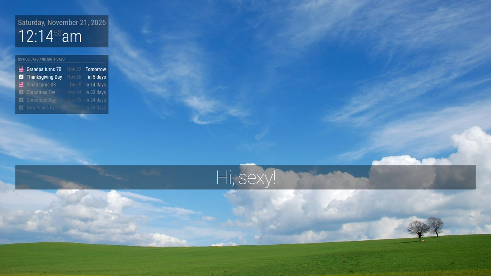
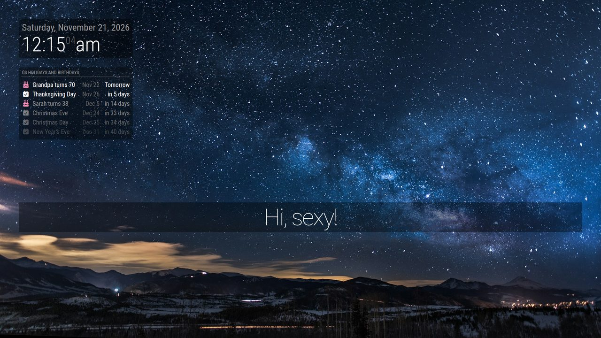
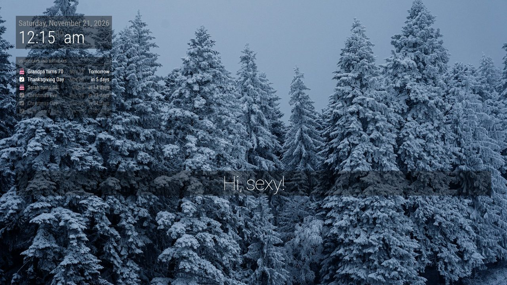
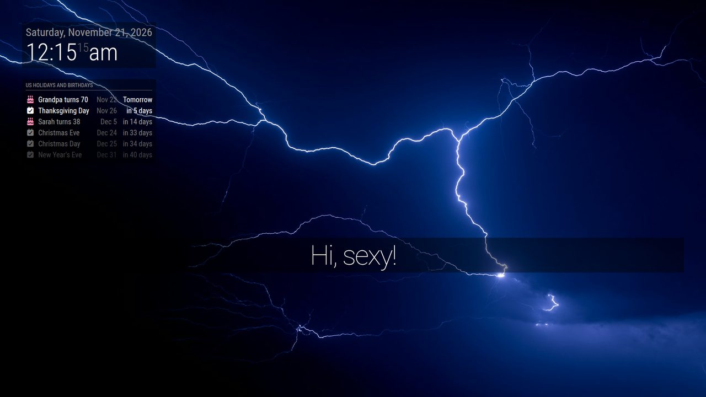

# MMM-WeatherBackgroundV4

A [MagicMirror²](https://github.com/MagicMirrorOrg/MagicMirror) module that fills the screen with a photo
matching the current weather: clouds, rain, snow, fog, storms and more. There are separate **night**
photos, and they switch on their own at sunrise and sunset. All 28 photos are sharp 1920×1080.

It's a companion to **[MMM-NOAAV4](https://github.com/cowboysdude/MMM-NOAAV4)**. MMM-NOAAV4 gets the
weather, and this module picks the picture.

## Screenshots

| Day: partly cloudy | Night: clear |
|:---:|:---:|
|  |  |

| Day: snow | Night: thunderstorm |
|:---:|:---:|
|  |  |

Each module gets a see-through dark box behind it, so the text stays easy to read on any photo.

---

## Requirements

- MagicMirror² 2.3x
- **[MMM-NOAAV4](https://github.com/cowboysdude/MMM-NOAAV4)** installed and in your config. That's
  where the weather comes from.

## Install

```bash
cd ~/MagicMirror/modules
git clone https://github.com/cowboysdude/MMM-WeatherBackgroundV4
```

**Do I need to run `npm install`?** No. The module has no dependencies.

## Add it to your config

In `~/MagicMirror/config/config.js`, inside `modules: [ ... ]`:

```js
{
  module: "MMM-WeatherBackgroundV4",
  config: {
    opacity: 0.4
  }
},
```

It needs **no `position`**. It draws behind everything else on the screen. Restart MagicMirror once
to see it. The photo appears as soon as MMM-NOAAV4 loads the weather.

## Options

| Option | Default | What it does |
|---|---|---|
| `opacity` | `0.3` | How dark the box behind each module is: `0` = no box, `1` = solid black. Raise it if text is hard to read. |
| `moduleBackground` | `true` | Set to `false` to turn the dark boxes off completely. |
| `modulePadding` | `"10px"` | Space inside the dark boxes. |
| `fitBoxes` | `true` | Each dark box hugs its module instead of filling the module's whole slot. Full-width bars (like a news ticker) stay full width. `false` = the old full-slot boxes. |
| `noBox` | `["MMM-NOAAV4"]` | Modules that get no dark box, because they draw their own card. Add more names, e.g. `["MMM-NOAAV4", "clock"]`. |
| `fadeSpeed` | `2` | Seconds the photo takes to fade to the next one. |
| `images` | `{}` | Use your own photos (see below). |
| `notification` | `"WEATHER"` | The message MMM-NOAAV4 sends. Leave it alone unless you know you need to change it. |
| `targetDOM` | `".region.fullscreen.below"` | Where the photo is drawn. Leave it alone unless you know you need to change it. |

## Your own photos

Put the pictures in the module folder (or anywhere MagicMirror can reach) and list them by weather type.
Add `n_` in front for the night version:

```js
config: {
  images: {
    rain: "modules/MMM-WeatherBackgroundV4/my-photos/rain.jpg",
    n_rain: "modules/MMM-WeatherBackgroundV4/my-photos/rain-night.jpg",
    snow: "https://example.com/snow.jpg"
  }
}
```

Weather types MMM-NOAAV4 can send: `clear`, `sunny`, `mostlysunny`, `partlycloudy`, `mostlycloudy`,
`cloudy`, `overcast`, `wind`, `breezy`, `fog`, `hazy`, `drizzle`, `chancerain`, `rain`, `chancetstorms`,
`tstorms`, `sleet`, `flurries`, `chancesnow`, `snow`.

## How day and night work

MMM-NOAAV4 sends today's sunrise and sunset along with the weather. This module checks every minute,
so the photo switches to the night version right at sunset and back at sunrise, even between weather
updates. With the older MMM-NOAA3, which only sends sunset, anything after sunset or before 6 am counts
as night.

## Troubleshooting

| What you see | What to do |
|---|---|
| No photo at all | Make sure MMM-NOAAV4 is in your config and showing weather. The photo only appears once the weather has loaded. |
| Text is hard to read | Raise `opacity`, e.g. `0.5` or `0.6`. |
| Photo doesn't change at sunset | Update MMM-NOAAV4 to the latest version, which sends sunrise and sunset. |
| `No picture for "..."` in the log | That weather type has no photo. Add one with the `images` option. |

## What changed in V4

- New name: **MMM-WeatherBackgroundV4**. Had the old module? See *Upgrading* below.
- All new sharp 1920×1080 photos in the `photos` folder, replacing the old blurry ones.
- "Chance of rain" now has its own photo.

## Upgrading from MMM-WeatherBackground

1. Install this module (see *Install*).
2. In `config.js`, change `module: "MMM-WeatherBackground"` to `module: "MMM-WeatherBackgroundV4"`.
3. Delete the old folder: `rm -rf ~/MagicMirror/modules/MMM-WeatherBackground`

## Earlier changes (v2)

- Works with **MMM-NOAAV4**. Every weather type it reports now has a day and a night photo.
- Fixed night detection: before sunrise now shows night photos, not daytime ones.
- The photo switches at sunrise and sunset on its own, without waiting for a weather update.
- Removed links to photos that didn't exist, which used to leave the screen blank.
- No longer needs moment.js, and no `npm install` step.
- New `images` option for your own photos, plus `moduleBackground`, `modulePadding` and `fadeSpeed`.

## Photo credits

All photos are from [Unsplash](https://unsplash.com), free to use under the [Unsplash License](https://unsplash.com/license).

| Photo | Photographer |
|---|---|
| `clear.jpg` | [Asim Rehman](https://unsplash.com/@_asimrehman) |
| `partlycloudy.jpg` | [Carmine Savarese](https://unsplash.com/@carminesavarese) |
| `mostlycloudy.jpg` | [Daniel Way](https://unsplash.com/@wanielday) |
| `cloudy.jpg` | [engin akyurt](https://unsplash.com/@enginakyurt) |
| `overcast.jpg` | [Vita Leonis](https://unsplash.com/@myfunkypixel) |
| `fog.jpg` | [Ricardo Gomez Angel](https://unsplash.com/@rgaleriacom) |
| `hazy.jpg` | [Stephan Louis](https://unsplash.com/@stephanlouis) |
| `drizzle.jpg` | [Max van den Oetelaar](https://unsplash.com/@maxvdo) |
| `chancerain.jpg` | [Wes Hicks](https://unsplash.com/@sickhews) |
| `rain.jpg` | [Dana Marin (Amsterdamian)](https://unsplash.com/@amsterdamian) |
| `tstorms.jpg` | [Johannes Plenio](https://unsplash.com/@jplenio) |
| `sleet.jpg` | [Abhishek Tiwari](https://unsplash.com/@abhi_2410) |
| `flurries.jpg` | [Chandler Cruttenden](https://unsplash.com/@chanphoto) |
| `chancesnow.jpg` | [Fabrizio Conti](https://unsplash.com/@conti_photos) |
| `snow.jpg` | [Antonia Glaskova](https://unsplash.com/@glaskova) |
| `n_clear.jpg` | [Nathan Anderson](https://unsplash.com/@nathananderson) |
| `n_partlycloudy.jpg` | [Ciocan Ciprian](https://unsplash.com/@cipriann) |
| `n_mostlycloudy.jpg` | [Spencer Arquimedes](https://unsplash.com/@spencerarquimedes) |
| `n_cloudy.jpg` | [Andriyko Podilnyk](https://unsplash.com/@andriyko) |
| `n_overcast.jpg` | [Clark Gu](https://unsplash.com/@atluminon) |
| `n_fog.jpg` | [Rhamely](https://unsplash.com/@rhamely) |
| `n_hazy.jpg` | [Yiran Ding](https://unsplash.com/@yiranding) |
| `n_rain.jpg` | [Red Shuheart](https://unsplash.com/@mirrors_are_more_fun) |
| `n_tstorms.jpg` | [Leon Contreras](https://unsplash.com/@lc_photography) |
| `n_sleet.jpg` | [Glenn Carstens-Peters](https://unsplash.com/@glenncarstenspeters) |
| `n_flurries.jpg` | [Anastasia Zolotukhina](https://unsplash.com/@stef_enheart) |
| `n_chancesnow.jpg` | [Dillon Kydd](https://unsplash.com/@kyddvisuals) |
| `n_snow.jpg` | [Polina Grishma](https://unsplash.com/@polina_grishma) |

## Credits

Originally created by Seongnoh Sean Yi ([eouia](https://github.com/eouia)), modified by **cowboysdude**
for MMM-NOAA3 and now MMM-NOAAV4. MIT License.
